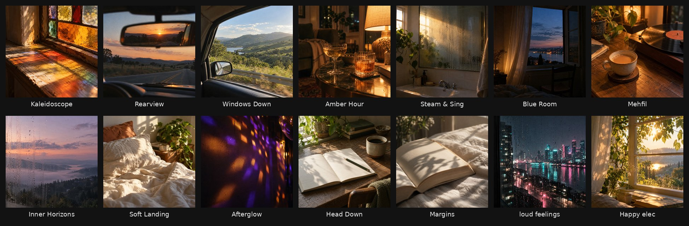
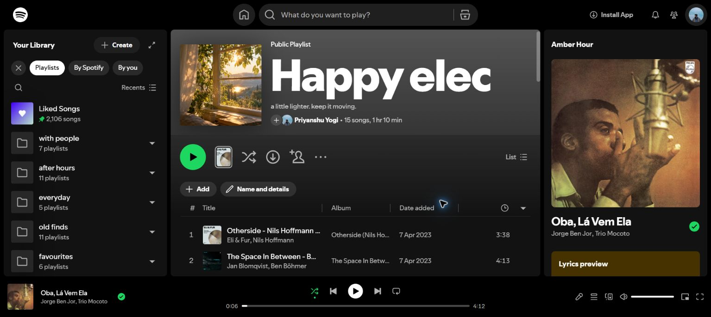
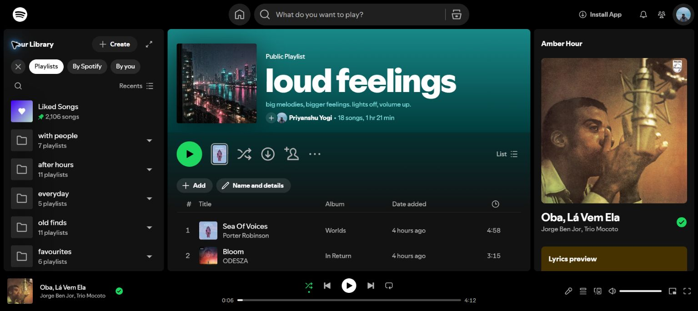

# Spotify Mood Curator

A Claude skill that studies your actual Spotify listening and builds playlists for moods and activities (driving, road trips, drinks with friends, shower, sad evenings, focus, a trip) that sound like you, while still taking a few risks.

I built this because my library had become a pile of Shazam imports and half-finished playlists. Spotify's own mixes kept giving me the same 30 songs. I wanted playlists for specific moments that actually understood what I listen to, including the parts that don't fit one genre: grunge and Pink Floyd, but also ghazals, Hindi indie and desi hip-hop.

*One run: 14 playlists, each with a generated cover in a shared film-photo style and no text or logos.*

## Results

- **19 playlists** built or refreshed from one taste audit (15 new mixes, 4 of my old playlists extended), and a 42-playlist library sorted into 5 folders.
- **I liked almost every song.** When I asked for more, the expansion pass added 21 songs from new directions (CAN, Mdou Moctar, Jorge Ben Jor, Cocteau Twins) instead of repeating what I already had.
- **Friends liked them too.** I shared the playlists with friends and they liked them, an early sign it isn't only fitting my taste.
- **What I'd change:** the first batch was too safe. It played my existing favourites back to me. Adding a deliberate share of discoveries (see below) fixed that.

These are honest impressions, not measured skip rates yet. A proper keep/skip check is on the roadmap.

| Library sorted into folders | A finished mix with its cover and description |
|---|---|
|  |  |

## How it works

There are two ways to run it. This section describes the **browser route**: the skill runs inside Claude with browser access to your logged-in Spotify web player, with no Spotify API or developer app. The **CLI route** does the same loop through the Spotify Web API (see [API version](#api-version) below).

1. **Account check.** It confirms which Spotify account is logged in before touching anything.
2. **Taste audit.** It reads your top songs, top artists, recent plays, Liked Songs (sampling both the newest and oldest), your own playlists and shared ones, then weights them:
   - plays > saves > your own playlists > shared playlists (your additions count more) > algorithmic/followed playlists
   - playlists it created earlier in the same session are excluded, so it doesn't learn from its own picks
   - it writes `Listening Notes.md`, an evidence-backed summary of your taste and its limits
3. **Plan.** It writes a plan for each playlist: purpose, track list, an evidence label on every track (`known_history_track`, `known_artist_extension`, `exploratory`, ...), a version policy (no sped-up, lo-fi or accidental live versions) and notes on the order.
4. **Approval.** It shows you the plan before writing to your account. It never edits, reorders or deletes your existing playlists without asking.
5. **Build.** It creates the playlists in the web player and writes a progress file as it goes, so an interrupted run picks up where it stopped instead of adding duplicates.
6. **Verify.** It reloads each playlist and compares what Spotify actually saved against the plan: count, order, duplicates and versions.
7. **Polish (optional).** Text-free covers in a consistent film-photo style, library folders (`everyday`, `after hours`, `with people`, `favourites`, `old finds`), and a hand-off doc with every tracklist.

## Curation rules that made the difference

- **Familiar songs plus discoveries.** About 60 to 75% of each playlist is your favourites or other songs by artists you already like. The remaining 25 to 40% is genuine discovery outside your usual patterns. My first run was too literal, and this ratio came from that feedback.
- **Discovery chapters.** When a playlist is expanded, the new songs go in as a block at the end with their own small arc, instead of being mixed into the original order.
- **Every playlist has an arc.** A gentle start, a build, a peak and a calm ending. Neighbouring songs avoid jarring jumps in tempo, language or loudness, and bridge songs carry the playlist from one style to the next.
- **Regional and language music gets its own lane** when the data supports it, instead of being treated as an occasional extra.
- **Descriptions sound like a person wrote them.** Lowercase and one line, for example "bathroom acoustics doing half the work."

## Example output (from my own run)

| Playlist | For | Direction |
|---|---|---|
| Rearview | everyday driving | Pearl Jam, Stone Temple Pilots, Foo Fighters, then a discovery stretch with The War On Drugs, Mdou Moctar, Tinariwen, NEU! |
| Amber Hour | drinks with friends | warm funk and indie, opening into Jorge Ben Jor, The Lijadu Sisters, SAULT, Cymande |
| Blue Room | sad and reflective | slow songs for sitting with a feeling, ending on Weyes Blood, Nick Drake, Slowdive, Cocteau Twins |
| Mehfil | ghazals, quiet evenings | Jagjit Singh, Ghulam Ali, Talat Aziz, Noor Jehan, then Ali Sethi and Arooj Aftab |
| Kaleidoscope | psychedelic rock trip | The Beatles, Jefferson Airplane, Donovan, Hendrix, Pink Floyd, then CAN, Kikagaku Moyo, Dungen |
| car-o-bar | party with friends | 50 songs moving between funk, Hindi and Punjabi hooks, desi hip-hop, rock singalongs and disco |

In total the run built or refreshed 19 playlists and organized a 42-playlist library into five folders.

## API version

`curator` is a Python CLI that runs the same audit, plan, approve, build and verify loop through the Spotify Web API. It's faster, it doesn't break when Spotify's UI changes, and every decision is written to a file you can inspect.

- **Claude proposes songs, your data labels them.** Each song comes back marked played, saved, by an artist you play, or new, computed from your Spotify data rather than taken from the model.
- **No API key needed.** Without `ANTHROPIC_API_KEY`, `curator plan` writes a prompt you paste into a Claude chat, or the Claude running the skill writes the plan itself.
- **Two live runs on a real account:** 25 of 25 and 30 of 30 songs saved in the planned order, with no duplicates. The first showed the planner overestimates novelty: 2 of 7 planned "discoveries" weren't new, and the labels caught both.

Setup, commands and both runs: [docs/api-version.md](docs/api-version.md). `SKILL.md` covers both routes.

## Install

**Claude (claude.ai / desktop):** add `SKILL.md` as a skill, or upload this folder through the skills settings.

**Claude Code:** copy the folder into `~/.claude/skills/spotify-mood-curator/`.

Then ask something like:

> Go through my Spotify, understand my taste, and make me playlists for driving, a road trip with friends, drinks, the shower and sad evenings. Be adventurous with discoveries.

You need a browser tool Claude can drive (Claude in Chrome or the desktop browser pane) and to be logged in to open.spotify.com.

## Why the browser and not the Spotify API?

This was a fair trade-off for a personal experiment, not the right choice for a product.

- **Speed of trying it.** No developer app, OAuth setup or token handling. I could test whether the curation logic was any good in one evening.
- **The API lost the parts that matter for music reasoning.** In late 2024 Spotify restricted new apps from endpoints such as recommendations, related artists and audio features (tempo, energy and so on). Reading top tracks and saved songs and creating playlists still works, but the musical judgement has to come from the model either way.
- **The web player shows things the API doesn't surface easily**, like the play counts on your all-time top songs.

The costs are real:

- **Terms of use.** Spotify's terms restrict automated access to the service. Run this only on your own account, at your own pace, and read the terms yourself. This is a personal-use experiment, not a tool for automating Spotify at scale.
- **Fragility.** Any UI change can break a step, and clicking through the interface is slow (a full library pass took hours).

The interesting part is the agent design (evidence weighting, a plan you approve, resumable progress files and verification against what was actually saved), and it carries over unchanged to the [API version](#api-version), which is now the recommended route. The browser route is still the one that can make library folders and upload covers.

## Limitations

- **It sees a sample, not your full history.** It reads what the web player shows, not a lifetime export. For deeper history, use [Exportify](https://exportify.net) or Spotify's "Download your data" (extended streaming history).
- **Tested on one account so far: mine** (plus friends listening to the shared results). The discovery ratio and lane rules may be tuned to my taste. Results from other listeners are welcome.
- **No measured evaluation yet.** Next up is a keep/skip check a week after creation, comparing familiar songs with discoveries.
- It never claims a song is "safe" or will create a particular experience under the influence. A trip playlist is about musical arc, nothing more.

## Roadmap

- [ ] Test on 2 to 3 listeners with different taste
- [ ] Keep/skip evaluation one week after a run
- [x] Spotify Web API path for reading history and writing playlists, keeping the same plan, approve and verify loop
- [ ] Automatic re-plan when the discovery share misses the target

## License

MIT
